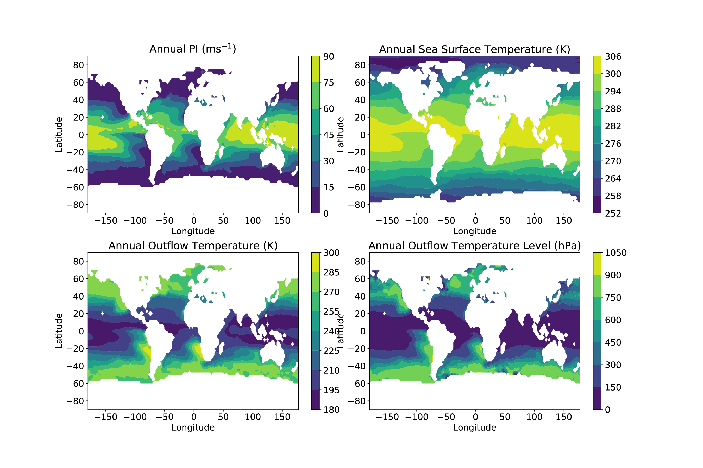

# tcpyPI: Potential Intensity Calculations in Python
<p align="center">

</p>

tcpyPI, 'pyPI' for short, is a set of scripts and notebooks that compute and validate tropical cyclone (TC) potential intensity (PI) calculations in Python.
It is a fully documented and improved port of the [Bister and Emanuel 2002](https://agupubs.onlinelibrary.wiley.com/doi/full/10.1029/2001JD000776) algorithm (hereafter BE02) which was originally written in FORTRAN---and then MATLAB---by Prof. Kerry Emanuel (MIT).
Kerry's original MATLAB code (**pcmin.m**) is found at:

* [http://texmex.mit.edu/pub/emanuel/TCMAX](http://texmex.mit.edu/pub/emanuel/TCMAX)

The goals in developing and maintaining pyPI are to:
* supply a freely available validated Python potential intensity calculator,
* carefully document the BE02 algorithm and its Python implementation, and to
* demonstrate and encourage the use of potential intensity theory in tropical cyclone climatology analysis.

If you have any questions, comments, or feedback, please [contact the developer](mailto:dgilford@climatecentral.org) or open an [Issue](https://github.com/dgilford/pyPI/issues) in the repository. A paper detailing pyPI is published [at Geoscientific Model Development](https://gmd.copernicus.org/articles/14/2351/2021/gmd-14-2351-2021.pdf).

## Citation
pyPI was developed by [Daniel Gilford](https://github.com/dgilford) and has been archived on Zenodo:

[](https://doi.org/10.5281/zenodo.3756005)

If you use pyPI in your work, please include the citations:

> Gilford, D. M.: pyPI (v1.3): Tropical Cyclone Potential Intensity Calculations in Python, Geosci. Model Dev., 14, 2351–2369, https://doi.org/10.5194/gmd-14-2351-2021, 2021.

and

> Gilford, D. M. 2020: pyPI: Potential Intensity Calculations in Python, pyPI v1.3. Zenodo. http://doi.org/10.5281/zenodo.3985975


## Full pyPI Description

Please read [pyPI_Users_Guide_v1.3.pdf](pyPI_Users_Guide_v1.3.pdf) for a full overview and details on pyPI.
The description includes the pyPI background, a PI computation derivation, validation against the commonly-used MATLAB algorithm (pcmin), and a set of sample analyses.

## Getting Started

pyPI requires **Python version 3.7+** to run.
To get pyPI up and running on your system, clone the repository and ensure that you have the required dependencies.

### Installation

pyPI is packaged using the python package manager [pip](https://pip.pypa.io/en/stable/).

[](https://badge.fury.io/py/tcpypi)

To install tcpypi from the command line:

```bash
pip install tcpypi
```

### tcpyPI Dependencies

* NumPy
* [Numba](http://numba.pydata.org/)

Not required by tcpyPI---but highly recommended!---is the versatility in calculating PI over large datasets provided by [xarray](http://xarray.pydata.org/en/stable/).
Dependency versions were originally handled by [Dependabot](https://dependabot.com/), but the code was not resilient to these changes so they are currently defunct (as of 10 August 2022). Please [notify me](mailto:dgilford@climatecentral.org) immediately if installation problems persist.

### Python Implementation of "pc_min" (BE02 PI Calculator)

[pi.py](src/tcpyPI/pi.py) is the Python function which directly computes PI given atmospheric and ocean state variables (akin to the BE02 algorithm MATLAB implementation [pc_min.m](matlab_scripts/pc_min.m)). Given input vector columns of environmental atmospheric temperatures (T) and mixing ratios (R) on a pressure grid (P), sea surface temperatures (SST), and mean sea-level pressures (MSL), the algorithm outputs potential intensity, the outflow level, the outflow temperature, and the minimum central pressure, and a flag that shows the status of the completed PI calculation. pyPI is an improvement on pcmin in that it handles missing values depending on user input flags.

Users who want to apply the PI calculation to a set of local environmental conditions need only to download [pi.py](./src/tcpyPI/pi.py), organize their data appropriately, and call the function to return outputs, e.g.:
```
(VMAX,PMIN,IFL,TO,LNB)=pi(SST,MSL,P,T,R)
```

### Sensitivity & Configuration Options

`tcpyPI.pi()` exposes a few key “sensitivity knobs” that can materially change results. The most commonly explored options are:

- `CKCD` (default `0.9`): exchange coefficient ratio (`Ck/Cd`).
- `diss_flag` (default `1`): include (`1`) or exclude (`0`) dissipative heating.
- `ascent_flag` (default `0`): reversible (`0`) vs pseudo-adiabatic (`1`) ascent assumption.
- `V_reduc` (default `0.8`): reduction from gradient wind to 10 m wind speed.
- `ptop` (default `50` hPa): top pressure bound; setting too high can bias outflow level/temperature.
- `miss_handle` (default `1`): missing-profile handling; `1` returns missing on any NaNs.
- `outflow_source` (default `"cape_star"`): how outflow level/temperature are defined:
  - `"cape_star"`: outflow is the LNB (`OTL`) and temperature (`T0`) from the saturated CAPE* calculation (default; BE02/pcmin behavior).
  - `"cape_env"`: outflow is the LNB and temperature from the environmental CAPE (CAPEenv) on the final convergence iteration (see Gilford et al. 2021 discussion). Where the environmental parcel has no level of neutral buoyancy, the outflow is undefined and outputs are missing with `IFL=4` (v1.5+), except where VMAX/PMIN do not depend on it (`diss_flag=0`, or CAPE* = 0), where only `TO`/`OTL` are missing. This removes dry/stable columns preferentially, so compare against `"cape_star"` on the common set of valid columns. Expect shallow outflows in much of the subtropics: where a trade inversion caps the environmental parcel, its LNB lies in the lower troposphere (OTL ~850 hPa), so the warmer outflow gives a substantially lower VMAX than `"cape_star"`. This is a physical result of the CAPEenv definition, not an error. CAPEenv outflow is also sensitive in marginal profiles: small input changes can switch the environmental LNB between deep and shallow layers, shifting PMIN by tens of hPa in a small fraction of columns.

**Changes in v1.5:** `cape()` now implements the 2017 JMIN fix from pcmin.m (levels below the parcel no longer enter CAPE during the PI iteration; [#89](https://github.com/dgilford/tcpyPI/issues/89)). PI was slightly too intense before. On the sample data (40°S–40°N ocean, 41,588 converged columns), PMIN rises by 0.88 hPa on average (up to 7.9 hPa; 2.1 hPa on average where PMIN < 960 hPa) and VMAX falls by 0.17 m/s on average (up to 1.2 m/s); columns with PMIN ≥ 1000 hPa are unchanged. The shift is nearly one-signed (64 columns move slightly the other way, by < 0.9 hPa and < 0.15 m/s). Over the full sample, including high latitudes, a handful of marginal columns (8 of 54,596) drop from VMAX ≈ 2 m/s to 0, because pcmin.m returns zero CAPE when the parcel is buoyant only at the first level above it. Under `"cape_env"`, PMIN shifts are larger in a few columns where the fix flips the environmental LNB between deep and shallow layers. The `"cape_env"` no-LNB case now returns `IFL=4` ([#90](https://github.com/dgilford/tcpyPI/issues/90)), and when CAPE* = 0 the outflow `TO`/`OTL` are reported as missing rather than the sentinel values `T[0]`/`0` (so efficiency-based diagnostics are also missing there). Note that the bundled [pc_min.m](matlab_scripts/pc_min.m) predates the 2017 JMIN revision.

Example:

```python
from tcpyPI import pi

vmax, pmin, ifl, t0, otl = pi(SSTC, MSL, P, TC, R, CKCD=0.9, diss_flag=1, outflow_source="cape_env")
```

### Log Decomposition (Wing et al. 2015)

tcpyPI provides a simple API for log-decomposing PI into efficiency, disequilibrium, and `Ck/Cd` terms (where `lnpi = ln(V^2)`):

```python
from tcpyPI import log_decompose_pi, pi_log_decomposition

out = pi_log_decomposition(SSTC, MSL, P, TC, R, CKCD=0.9)  # SSTC/TC in Celsius
lnpi, lneff, lndiseq, lnCKCD = log_decompose_pi(out["vmax"], SSTC, out["t0"], CKCD=0.9, sst_units="C")
```

### Running a pyPI Sample

Included in the pyPI release is a sample script [run_sample.py](run_sample.py) which runs global sample data from MERRA2 (in 2004) through pi.py, vectorizes the output, and performs several simple analyses. To run, simply:
```
python run_sample.py
```
and examine the outputs locally produced in [full_sample_output.nc](./data/full_sample_output.nc).

## File Descriptions

#### Key files
* **[pi.py](./src/tcpyPI/pi.py)** - The primary function of pyPI, that computes and outputs PI (and associated variables) given atmospheric and ocean state variables.
* **[run_sample.py](run_sample.py)** - Example script that computes PI and accompanying analyses over the entire sample dataset

#### Data
* [sample_data.nc](./data/sample_data.nc) - Sample atmospheric and ocean state variable data and BE02 MATLAB output data; values are monthly averages over the globe from MERRA2 in 2004.
* [mdr.json](./data/mdr.json) - Main Development Region definitions from [Gilford et al. (2017)](https://journals.ametsoc.org/doi/abs/10.1175/JCLI-D-16-0827.1)
* [raw_sample_output.nc](./data/raw_sample_output.nc) - Sample outputs from pi.py *only* created by run_sample.py
* [full_sample_output.nc](./data/full_sample_output.nc) - Full set of sample outputs from pi.py as well as sample analyses such as PI decomposition

#### Validation and Testing Notebooks
* **[test_pi_calc.ipynb](./notebooks/test_pi_calc.ipynb)** - Simple code showing a single call of pi.py and testing the speed of the algorithm
* **[verify_pi.ipynb](./notebooks/verify_pi.ipynb)** - Notebook validating/verifying pyPI outputs against BE02 MATLAB output data
* **[sample_output_analyses.ipynb](./notebooks/sample_output_analyses.ipynb)** - Notebook showing examples of pyPI outputs and simple PI analyses

#### Misc.
* **[utilities.py](./src/tcpyPI/utilities.py)** - Set of functions used in the pyPI codebase
* **[constants.py](./src/tcpyPI/constants.py)** - Set of meteorological constants used in the pyPI codebase
* **[reference_calculations.m](./matlab_scripts/reference_calculations.m)** - Script used to generate sample BE02 MATLAB output data from original MERRA2 files monthly mean; included for posterity and transparency
* **[pc_min.m](./matlab_scripts/pc_min.m)** - Original BE02 algorithm from MATLAB, adapted and used to produce analyses of Gilford et al. ([2017](https://journals.ametsoc.org/doi/abs/10.1175/JCLI-D-16-0827.1); [2019](https://journals.ametsoc.org/doi/10.1175/MWR-D-19-0021.1))
* **[clock_pypi.ipynb](./notebooks/clock_pypi.ipynb)** - Notebook estimating the time it takes to run pyPI on a laptop

## Author

* **Daniel M. Gilford, PhD** - *Creation, Development, & Maintenance* - [GitHub](https://github.com/dgilford)

### Contributor(s)
* **Ben Mares** - *Modernization* - [GitHub](https://github.com/maresb)
* **Daniel Rothenberg, PhD** - *Numba Optimization & Sample Code* - [GitHub](https://github.com/darothen)

## License

This project is licensed under the MIT License - see the [LICENSE](LICENSE) file for details

## Acknowledgments

* Kerry Emanuel (MIT) - Development of potential intensity theory; encouragement and permission to pursue Python implementation
* Susan Solomon (MIT), Paul O'Gorman (MIT), Allison Wing (FSU) - Helpful conversations, advice, and suggestions on TC PI research
* Dan Chavas (Purdue), Jonathan Lin (MIT), Raphael Rousseau-Rizzi (MIT) - Feedback on pyPI code and documentation
